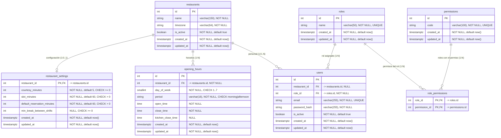

# DER vigente — Autenticación y autorización

Este documento refleja el esquema **real** del proyecto en la revisión Alembic
`21e1845af37f` (head). No es un DER propuesto: describe las tablas y restricciones
que existen hoy en `app/database/migrations/versions/`.

Alcance: las siete tablas de autenticación, autorización y configuración del
restaurante. El esquema completo tiene además `allergens`, `categories` y
`audit_logs`, que quedan fuera de este diagrama.

## Diagrama

Mermaid no representa `CHECK` ni índices; se documentan en las tablas siguientes.

## Claves y restricciones

### `restaurants`

| Elemento | Definición |
|---|---|
| PK | `pk_restaurants (id)` |
| Columnas | `id`, `name varchar(150) NOT NULL`, `timezone varchar(64) NOT NULL`, `is_active boolean NOT NULL DEFAULT true`, `created_at`, `updated_at` |

### `restaurant_settings`

| Elemento | Definición |
|---|---|
| PK | `pk_restaurant_settings (restaurant_id)` |
| FK | `fk_restaurant_settings_restaurant_id_restaurants` → `restaurants(id)` |
| CHECK | `courtesy_minutes >= 0` |
| CHECK | `slot_minutes > 0` |
| CHECK | `default_reservation_minutes > 0` |
| CHECK | `min_break_between_shifts IS NULL OR min_break_between_shifts >= 0` |

La PK es a la vez FK: como máximo una configuración por restaurante.

### `opening_hours`

| Elemento | Definición |
|---|---|
| PK | `pk_opening_hours (id)` |
| FK | `fk_opening_hours_restaurant_id_restaurants` → `restaurants(id)` |
| UNIQUE | `uq_opening_hours_restaurant_id_day_of_week_period (restaurant_id, day_of_week, period)` |
| CHECK | `day_of_week BETWEEN 1 AND 7` |
| CHECK | `period IN ('morning', 'afternoon')` |

### `users`

| Elemento | Definición |
|---|---|
| PK | `pk_users (id)` |
| FK | `fk_users_role_id_roles` → `roles(id)` — **NOT NULL** |
| FK | `fk_users_restaurant_id_restaurants` → `restaurants(id)` — NULL |
| UNIQUE | `uq_users_email (email)` |
| Índices | `ix_users_role_id`, `ix_users_restaurant_id` |

`users.role_id` es la **única** representación del rol del usuario. No existe
tabla `user_roles` ni relación muchos-a-muchos usuarios↔roles.

### `roles`

| Elemento | Definición |
|---|---|
| PK | `pk_roles (id)` |
| UNIQUE | `uq_roles_name (name)` |

### `permissions`

| Elemento | Definición |
|---|---|
| PK | `pk_permissions (id)` |
| UNIQUE | `uq_permissions_code (code)` |

### `role_permissions`

| Elemento | Definición |
|---|---|
| PK | `pk_role_permissions (role_id, permission_id)` |
| FK | `fk_role_permissions_role_id_roles` → `roles(id)` |
| FK | `fk_role_permissions_permission_id_permissions` → `permissions(id)` |

La PK compuesta impide asignar dos veces el mismo permiso al mismo rol.
Es una asociación rol↔permiso, no usuario↔rol.

## Cardinalidades

| Relación | Cardinalidad | Implementación |
|---|---|---|
| `restaurants` → `restaurant_settings` | 1 : 0..1 | PK/FK compartida `restaurant_id` |
| `restaurants` → `opening_hours` | 1 : N | FK `restaurant_id` + UNIQUE por día y periodo |
| `restaurants` → `users` | 1 : 0..N | FK `restaurant_id` NULL (superadmin y clientes no pertenecen a un restaurante) |
| `roles` → `users` | 1 : N | FK `users.role_id` NOT NULL |
| `roles` → `role_permissions` | 1 : N | FK `role_id` |
| `permissions` → `role_permissions` | 1 : N | FK `permission_id` |

## Relaciones ORM

Las relaciones ORM siguen exactamente las FK anteriores:

- `Restaurant.settings` ↔ `RestaurantSettings.restaurant` (1:0..1).
- `Restaurant.opening_hours` ↔ `OpeningHours.restaurant` (1:N).
- `Restaurant.users` ↔ `User.restaurant` (1:0..N).
- `Role.users` ↔ `User.role` (1:N).

## Notas de arquitectura

- La tabla se llama `restaurants`, en plural, según la convención del proyecto.
- Los modelos canónicos viven en `app/models/users.py` y
  `app/modules/settings/models/`.
- El historial Alembic canónico está en `app/database/migrations/versions/`.
  El directorio `alembic/` de la raíz es residual y no debe usarse.
- El DER anterior (migración residual `4f2d7c91ab06_align_restaurant_with_der.py`)
  unificaba settings y horarios en una tabla `restaurant` singular. Ese diseño
  está descartado y no representa el esquema vigente.
