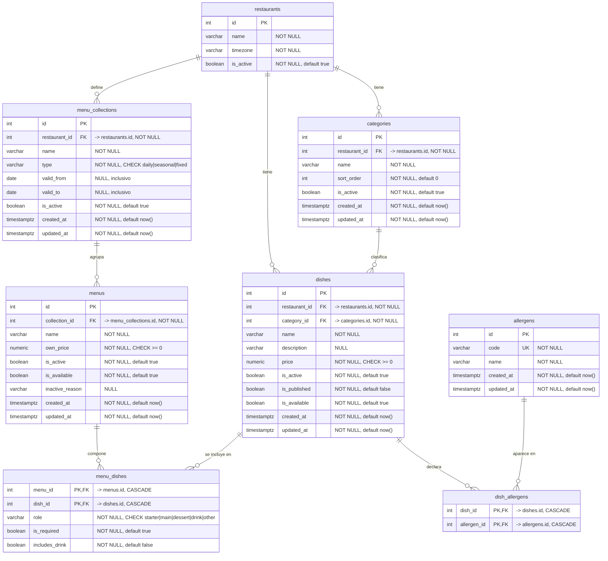

# DER vigente — Carta y menús

Este documento refleja el esquema **real** de la carta y los menús en la revisión
Alembic `b7d4e2a91c63` (hija de `21e1845af37f`). No es un DER propuesto: describe
las tablas y restricciones que crea la migración
`app/database/migrations/versions/b7d4e2a91c63_add_menu_schema.py`.

Alcance: las siete tablas de carta y menús. `restaurants` se incluye solo como
contexto; su definición completa está en `docs/der-autenticacion.md`.

## Diagrama

## Restricciones

| Tabla | Restricción | Definición |
|---|---|---|
| `categories` | UNIQUE | `uq_categories_restaurant_id_name (restaurant_id, name)` |
| `allergens` | UNIQUE | `uq_allergens_code (code)` |
| `dishes` | CHECK | `ck_dishes_price_non_negative (price >= 0)` |
| `dishes` | Índices | `ix_dishes_restaurant_id`, `ix_dishes_category_id` |
| `dish_allergens` | PK | `pk_dish_allergens (dish_id, allergen_id)` |
| `menu_collections` | UNIQUE | `uq_menu_collections_restaurant_id_name (restaurant_id, name)` |
| `menu_collections` | CHECK | `ck_menu_collections_type (type IN ('daily','seasonal','fixed'))` |
| `menu_collections` | CHECK | `ck_menu_collections_valid_range (valid_to IS NULL OR valid_from IS NULL OR valid_to >= valid_from)` |
| `menu_collections` | Índice | `ix_menu_collections_restaurant_id` |
| `menus` | UNIQUE | `uq_menus_collection_id_name (collection_id, name)` |
| `menus` | CHECK | `ck_menus_own_price_non_negative (own_price >= 0)` |
| `menus` | Índice | `ix_menus_collection_id` |
| `menu_dishes` | PK | `pk_menu_dishes (menu_id, dish_id)` |
| `menu_dishes` | CHECK | `ck_menu_dishes_role (role IN ('starter','main','dessert','drink','other'))` |

## Cardinalidades

| Relación | Cardinalidad | Implementación |
|---|---|---|
| `restaurants` → `categories` | 1:N | `categories.restaurant_id` |
| `restaurants` → `dishes` | 1:N | `dishes.restaurant_id` |
| `categories` → `dishes` | 1:N | `dishes.category_id` |
| `dishes` ↔ `allergens` | M:N | `dish_allergens`, PK compuesta |
| `restaurants` → `menu_collections` | 1:N | `menu_collections.restaurant_id` |
| `menu_collections` → `menus` | 1:N | `menus.collection_id` |
| `menus` ↔ `dishes` | M:N con atributos | `menu_dishes`, PK compuesta |

## Decisiones cerradas

1. **`is_required`** vive solo en `menu_dishes` y marca si el plato es obligatorio
   dentro del menú. `dish_allergens` es una asociación simple, sin flags.
2. **Bebida incluida**: se representa con `menu_dishes.role = 'drink'` para el plato
   de bebida y con `menu_dishes.includes_drink` como indicador independiente de que
   el menú la incluye.
3. **Vigencias**: solo en `menu_collections`. `valid_from` y `valid_to` son
   inclusivos, `valid_from = valid_to` es válido (un solo día) y se permiten
   solapamientos entre colecciones activas del mismo restaurante.
4. **Alcance temporal**: `menus` y `dishes` no tienen fechas; usan `is_active`,
   `is_available`, `is_published` e `inactive_reason`.
5. **Borrado**: las FKs de negocio son `NO ACTION`; las asociaciones
   `dish_allergens` y `menu_dishes` son `ON DELETE CASCADE`.
6. **Coherencia multi-restaurante**: se valida en la aplicación. La base de datos
   no impide que un plato use una categoría de otro restaurante ni que un menú
   incluya platos de otro restaurante.
7. **Precio del menú**: `menus.own_price` es obligatorio (`NOT NULL`, `>= 0`).
8. **Rol y unicidad**: `menu_dishes.role` es obligatorio y repetible; los nombres
   de platos no son únicos por restaurante.

## Notas de integridad

- `dish_allergens` y `menu_dishes` no tienen `created_at`/`updated_at`: son
  asociaciones, igual que `role_permissions`.
- No hay restricción de solapamiento de vigencias. Si el negocio decide impedirlo,
  hará falta una migración con `btree_gist` y `EXCLUDE USING gist`.
- La inclusividad de las fechas no se puede verificar en la base de datos: el
  `CHECK` solo impide un rango invertido. La semántica inclusiva se aplica en la
  capa de servicio.
- La coherencia multi-restaurante tampoco se puede verificar con las FKs actuales:
  requeriría FKs compuestas o triggers, y ninguna de las dos se ha adoptado.
